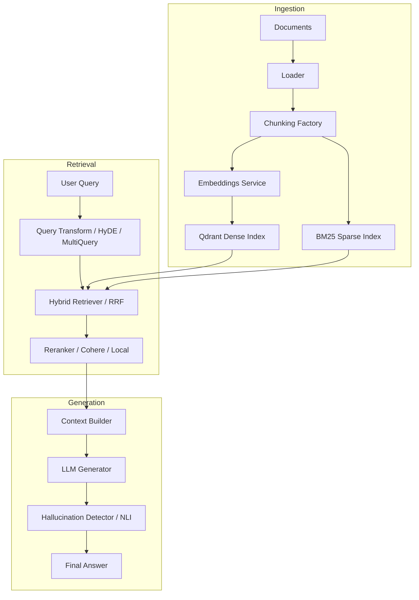

# RAG Eval Bench

A modular, production-ready evaluation bench for Retrieval-Augmented Generation (RAG) pipelines. This project facilitates systematic benchmarking and comparison of different chunking strategies, retrieval methods, generation settings, and hallucination detection techniques.

## Overview

RAG Eval Bench provides a testing ground to optimize RAG pipeline hyperparameters. By sweeping over chunking strategies, dense/sparse/hybrid retrievers, query rewrites, and reranking options, developers can measure and compare system performance across latency, cost, and retrieval quality metrics such as faithfulness, answer relevancy, context precision, context recall, and citation accuracy.

## Architecture



## Project Structure

```
rag-eval-bench/
├── src/
│   ├── config.py           # Configuration management
│   ├── dashboard/          # Streamlit visualization dashboard
│   │   ├── app.py          # Main Streamlit application
│   │   └── components.py   # Reusable UI components
│   ├── evaluation/         # Benchmarking and metrics calculation
│   │   ├── ablation.py     # Parameter sweeps/ablations
│   │   ├── benchmark.py    # Multi-configuration runner
│   │   ├── dataset.py      # Evaluation dataset loader
│   │   └── metrics.py      # RAGAS and custom metrics
│   ├── generation/         # Text generation and hallucination checks
│   │   ├── context_builder.py
│   │   ├── generator.py
│   │   ├── hallucination.py
│   │   └── memory.py
│   ├── ingestion/          # Document processing pipeline
│   │   ├── chunker.py
│   │   ├── embedder.py
│   │   ├── indexer.py
│   │   ├── loader.py
│   │   └── pipeline.py
│   └── retrieval/          # Search and retrieval layer
│       ├── dense.py
│       ├── sparse.py
│       ├── hybrid.py
│       ├── reranker.py
│       ├── query_transform.py
│       └── retriever.py
├── scripts/                # Helper utility scripts
├── tests/                  # Unit test suite
├── pyproject.toml          # Project configuration and dependencies
└── docker-compose.yml      # Qdrant service configuration
```

## Setup and Installation

1. Initialize and sync project dependencies using the uv package manager:
   ```bash
   uv sync --all-extras
   ```

2. Configure the environment variables:
   ```bash
   cp .env.example .env
   ```
   Open the `.env` file and populate the required API keys (e.g., `OPENAI_API_KEY` and optionally `COHERE_API_KEY`).

3. Start the Qdrant vector store service using Docker Compose:
   ```bash
   docker compose up -d
   ```

## Running the Application

### Ingesting Documents
To process, chunk, embed, and index files in your corpus directory:
```bash
uv run python -m src.ingestion.pipeline --corpus-dir data/corpus --strategy all
```

### Running Benchmarks
To run the RAG pipeline over the evaluation dataset with the entire 24-config matrix:
```bash
uv run python -m src.evaluation.benchmark --configs all --output results/
```

### Running Ablation Studies
To execute parameter sweeps on individual factors (chunk size, overlap, top-k, etc.):
```bash
uv run python -m src.evaluation.ablation --study all --output results/ablations/
```

### Starting the Dashboard
To launch the Streamlit visualization and interactive chatbot interface:
```bash
uv run streamlit run src/dashboard/app.py
```

## Testing

Run the test suite using pytest to verify system correctness:
```bash
uv run pytest
```
